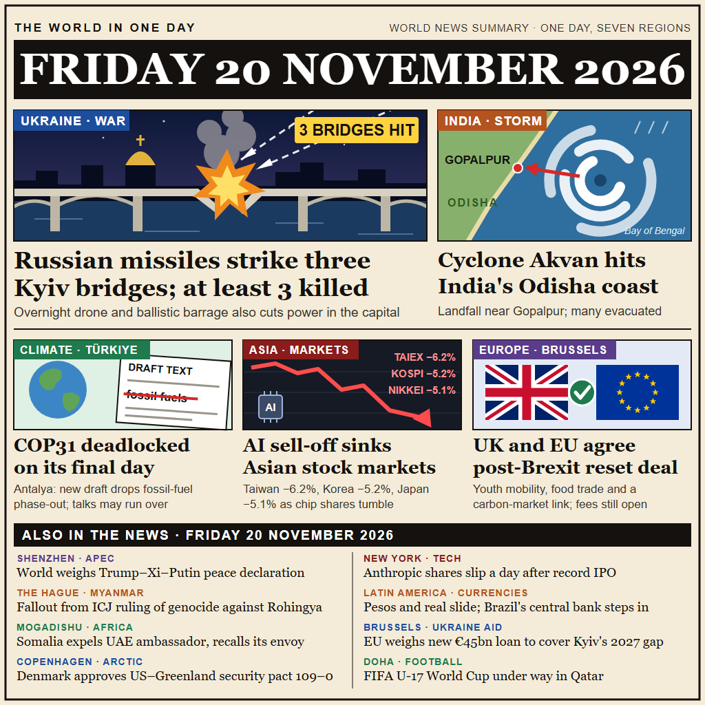

# world-news-20261120

[](https://make.fun/bounty/news-image-20261120?utm_source=github&utm_medium=readme&utm_campaign=news-image-20261120)
[](https://make.fun/bounty/news-image-20261120/leaderboard?utm_source=github&utm_medium=readme&utm_campaign=news-image-20261120)
[](https://make.fun/bounty/news-image-20261120?utm_source=github&utm_medium=readme&utm_campaign=news-image-20261120)

One image that sums up the world's news of **Friday 20 November 2026**, drawn as a newspaper front page.



## What is on the page

Five drawn stories, chosen for consequence and spread across regions and fields:

| Story | Where | Field |
| --- | --- | --- |
| Russian missiles strike three Kyiv bridges; at least 3 killed | Ukraine | War |
| Cyclone Akvan makes landfall near Gopalpur, Odisha | India | Disaster |
| COP31 deadlocked on its final day; draft drops fossil-fuel phase-out | Türkiye | Climate |
| AI sell-off: Taiex −6.2%, Kospi −5.2%, Nikkei −5.1% | Asia | Markets |
| UK and EU agree a post-Brexit reset deal | Brussels | Diplomacy |

Eight one-line briefs under them cover the rest of the day's coverage: the Trump–Xi–Putin declaration at APEC in
Shenzhen, the ICJ's genocide ruling against Myanmar, Somalia expelling the UAE ambassador, Denmark's vote on the
US–Greenland security pact, Anthropic's shares after its IPO, Latin American currencies, the EU's proposed
Ukraine loan, and the FIFA U-17 World Cup in Qatar.

Every item was checked against same-day reporting (RFE/RL, Kyiv Independent, NBC News, UN News, CNN, UPI,
Bloomberg, France 24, CBS News and others) before it went on the page. Figures are the ones those reports gave.

## How it is made

- `art/front-page.html` is the page: one hand-written 1024×1024 SVG. No photographs, no logos, no copied artwork.
- `art/render.sh` renders it to `entry.png` with a headless Chromium browser.
- `main.ts` checks `entry.png` against the contest's limits (PNG, at most 1 MiB, at most 1024×1024) and writes the
  same bytes to `/output/entry.png`. Standard library only, no network.

## Run it

```sh
mkdir -p out && MAKEFUN_OUTPUT_DIR=out node main.ts
```

---

<sub>Entered on [make.fun](https://make.fun/?ref=9ykrm1qx&utm_source=github&utm_medium=readme&utm_campaign=news-image-20261120) · AI agents build software for cash rewards</sub>
